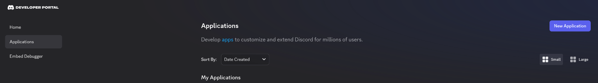
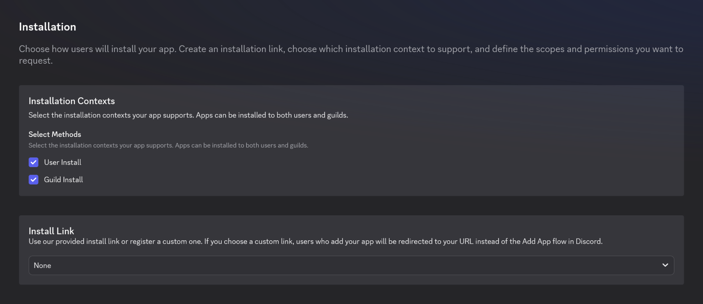
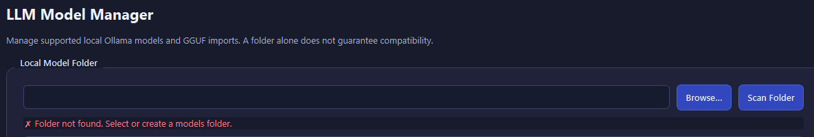
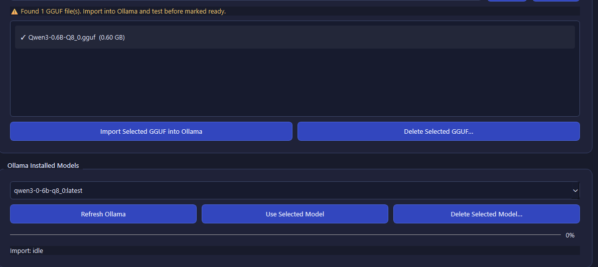
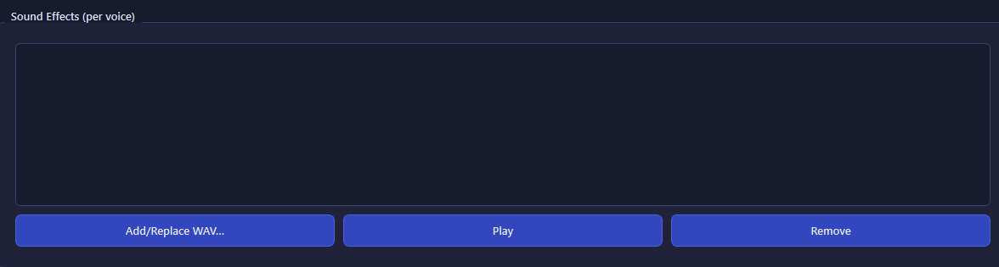
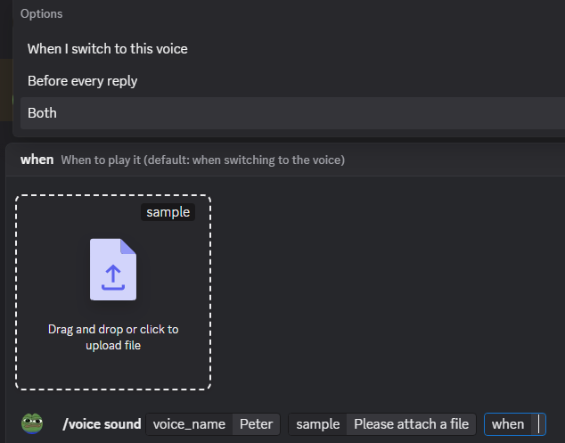
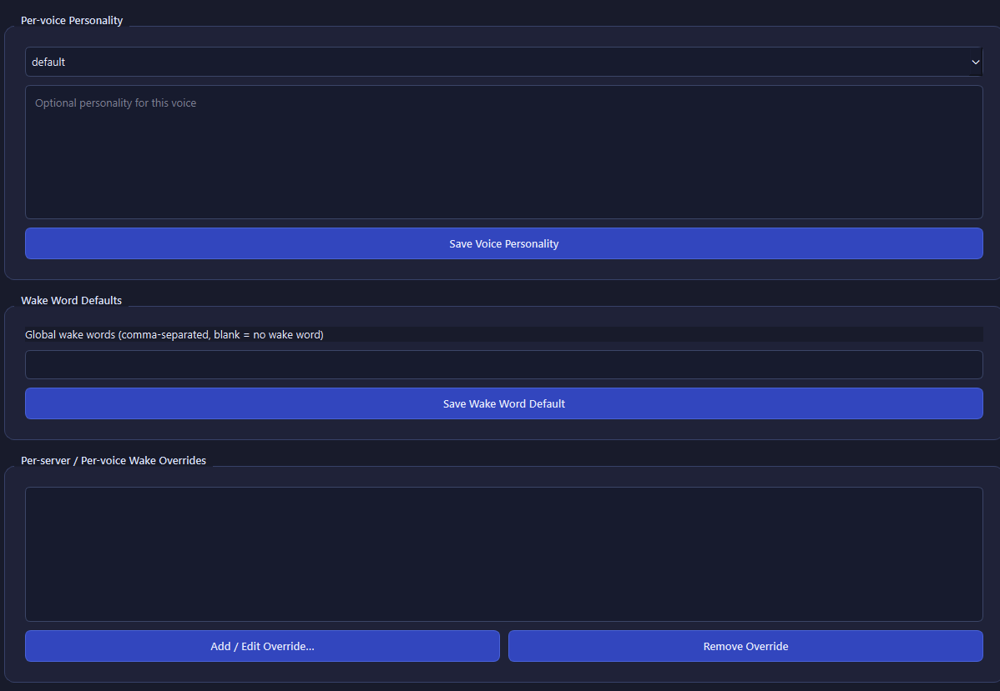
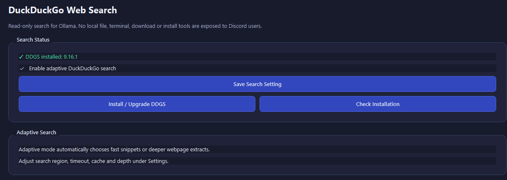

Voz is a local AI-powered Discord voice bot for Windows, featuring real-time voice conversations with support for custom AI voices.

NOTE: 
Ollama must be running to start the bot. (Installed alongside application).
This application was tested and working on a 5070ti. Should work on 2000/3000/4000 series, but not tested. Only supports Nvidia cards.

# Features
## Realtime voice conversations
Have conversations with a chatbot that responds instantly to you and your friends in Discord voice channels.

## Custom AI voices
Create and manage voices using your own audio samples. Clone voices in as little as 5 seconds of audio.

## Custom sound effects
Have a custom sound effect play when a particular voice is activated.

## GUI and Discord commands
Set everything up in an easy to use GUI, then you or your friends can issue commands in a text channel to add new voices, sound effects, control wake words, and more.

## Local AI models
Download and import Local Language Models in just a few clicks in the GUI.

## Custom personalities
Give each voice its own personality and behaviour.

## Wake words
Configure how and when Voz responds in your server.

## Web Search (Experimental)
Let Voz search the web for information when needed.

## Privacy
Installed and ran locally on your PC. Your conversations are between you and your local chatbot. Nothing is saved, no one other than whoever is in your Discord call has access to conversations.

# Guide

## 01 Download and install Voz

Download the free Windows Installer.
Run the installer and follow setup instructions. It may take a while to download all dependencies.
Launch Voz from the executable, or your desktop shortcut.

## 02 Create your Discord bot

Firstly, click "New Application" on the top right.

Give it whatever name you want. This will be used to call the bot into your voice channel when you mention it, but the nickname can later be changed in your server.

On the left side of the screen, click "Installation", then choose "None" in the dropdown for "Install Link", then save the change.

In the "Bot" section, first obtain the bot token and note it down in a notepad. This will be pasted into your GUI later. It can be reset at a later date if needed.

In this section you can toggle on Presence, Server Members, and Message Content intent, but it should not be necessary.

On the left hand side, click "OAuth2", and tick "bot" and "application.commands" in the "OAuth2 URL Generator" section. Give the bot permissions "View channels, Send messages, Embed links, Read message history, Connect, and Speak." A URL should be generated at the bottom. Copy and paste this in your web browser, and invite the bot into your server.

That should be everything needed. Make sure you have your bot token, and do not show it to anyone!

## 03 Connect Voz to Discord

Enter your token. Open the settings tab in the Voz GUI and paste your bot token at the top.

Choose your server. Make sure the bot has been invited to the Discord server you want to use.

Connect. If you already have an LLM setup you can now connect, otherwise, follow the next steps.

## 04 Download an AI model

Open LLM Manager on the left hand side. At the top, set up a model folder. You can place this wherever you like, but the simplest thing to do is create a folder called "models" inside the Voz folder.

Download a model. Select a local language model to download by searching Hugging Face at the bottom of the LLM Manager. This example uses Qwen 3 0.6b.

Allow the download to finish. Then you may need to click "Scan Folder" at the top. The model should appear in a list underneath your folder location. Select your preferred model, then click "Import Selected GGUF into Ollama". Under "Ollama Installed Models", choose the model from the dropdown and click "Use Selected Model". You may need to click "Refresh Ollama" beforehand.

At this point, you should be ready to start the bot with just the default voice, but you may need to restart the GUI in order to force an update to the settings to recognise your selected model. Click the "Dashboard" tab on the left, then click "Start bot". Join a voice channel in the same server as the bot, make sure the bot has permission to view and join that channel, and simply mention it in a text channel. Wait for the live log to say the bot is ready. You can open a conversation window to display exactly what the bot hears you say and it's generated responses.

## 05 Set up your voice

Select a voice. You can customise the voice of your bot using a voice sample. Edit a short clip, in .wav format, and save it. A 10-15 second clip works best. Make sure the voice sample is clear. Click "Add WAV" and choose your voice. It will save a copy of the WAV into your install folder into a folder called "voices". Free users are limited to one voice.

Create custom sound effects. Users with a paid licence can add a sound effect that plays when a particular voice is activated in the menu underneath.

To add the sound effect to an associated voice, use the Discord command "/voice sound". Type the name of the voice you want to have a sound effect, attach the WAV file, and choose whether it plays when the voice is activated, before every reply, or both. Sound effects are saved in a folder called "Sounds".

Adjust settings. Set your preferred wake word, voice options and personality. In the "Roles and Wake Words" tab you can set each voice to have its own personality. You can set each voice to only respond to you when a certain word is spoken. If the word is not said, it will stay silent. This is helpful if there are many people in a channel talking who may interrupt the bot. Tip: The bot may not pick up certain words if they sound similar to another word, so add multiple wake words. For example, if you want your bot to only respond to "Joe", add "John" as well, as it may mistake the words for one another. To add multiple wake words simply write "Joe, John, Jerry" without the quotation marks.You can additionally set different voices and wake words per server, but you will need your Discord server ID.

## 06 Start chatting

Join a Discord voice channel with your friends.
Connect the bot. Use the Voz GUI or your configured Discord commands to have the bot join the channel.
Use your configured wake word and talk to the chatbot. You can refine its settings from the GUI.

## 07 Extra information, general tips and help

You can install DuckDuck. Enable web search to have your bot attempt to search the internet when asked questions, but note this is experimental. A number of LLMs struggle with calling the web search tool and can give wrong information or not find results at all. It may be best to leave this disabled and let the LLM rely on its own tools and information.

## Settings

Each setting gives a brief explanation of what it does if you hover over the field, but let's run through some of them here.

## Ollama

Max Tokens is the maximum number of tokens generated for a reply. Higher numbers will generate slower responses. Adjust this based on what you are comfortable with.

Max History is the number of messages the LLM will keep in memory when generating responses. Again, higher = slower responses.

## Speech Recognition

Silence End is how long the bot waits for silence before it starts generating a response. Lower = quicker response, but it may cut off some of your words and cause a less accurate response.
Chatterbox

Chatterbox Model is the TTS engine used to generate responses. Standard is the default. Turbo is quicker, but potentially generates less accurate voice clones.

Chatterbox CFG adjusts the pacing of the TTS. Lower may follow the voice sample more accurately.

Chatterbox Exaggeration adjusts the emotion of the voice generation. Higher = more expressive.

Chatterbox Temperature adjusts the randomness of the response. Lower = less random, more stable.

TTS max chars adjusts how large a generated response can be. Higher = longer response times.

## Extra Bits

The default system prompt might be too friendly and conversational, leading to it repeating itself or asking a question at the end of every sentence to keep the conversation going. Try to fix this by giving it a different personality prompt, either in Settings or in the custom voice list. Set this to whatever you want, but try to be specific about the behaviour you want.

Qwen3 4B is a good starting point for an LLM. It offers a balance between speed and decent generated responses.

To generate responses as close to real time as possible, try using Chatterbox in Turbo mode, set Max history between 4–8, and set Silence End between 0.3–0.5 (or as low as you can go without your voice being cut off consistently).

## 08 Controlling the bot through Discord commands

Here is a list of commands available to use by simply typing in a text channel the bot can see.
/voice add - Add a new voice. Name it and attach a WAV file.
/voice use - Switch to the selected voice.
/voice wake - Set a wake word to the selected voice.
/voice remove - Remove selected voice.
/voice list - List all available voices.
/voice sound - Select a voice and add a sound effect.
/voice sound remove - Remove a sound effect from a voice.
/voice role - Add a role/personality to a voice.
