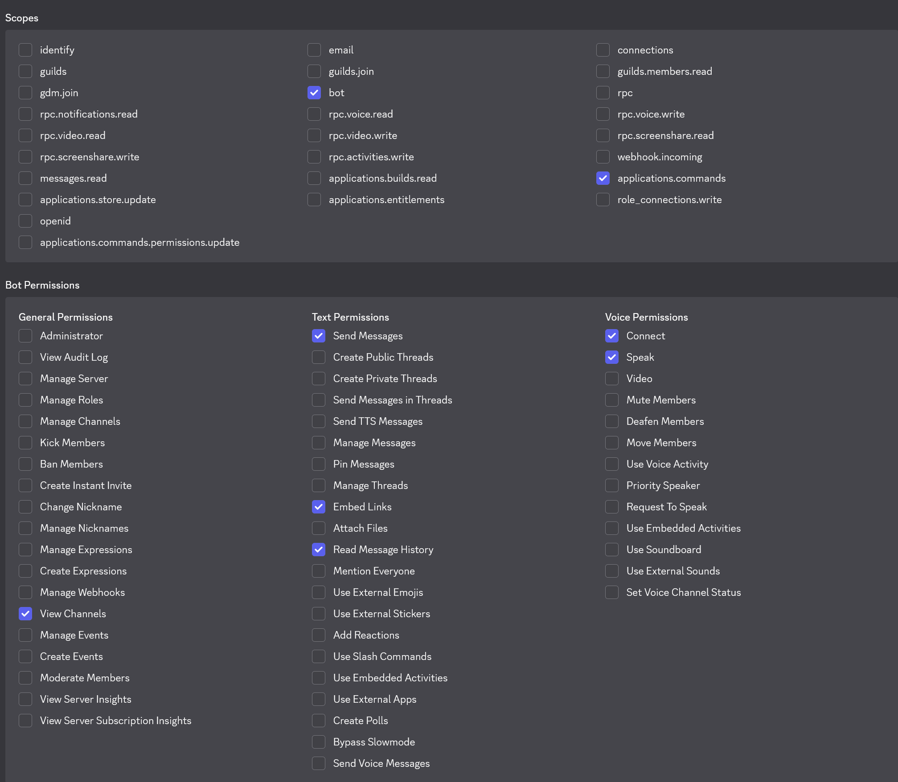
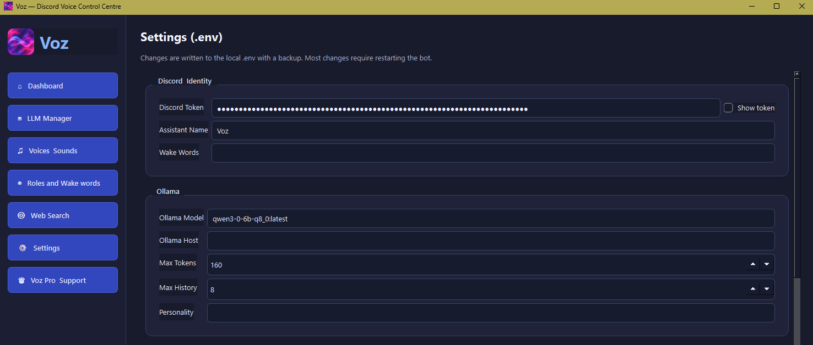
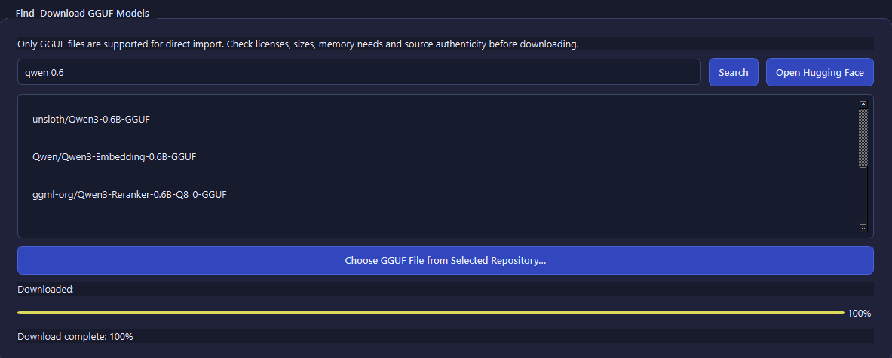
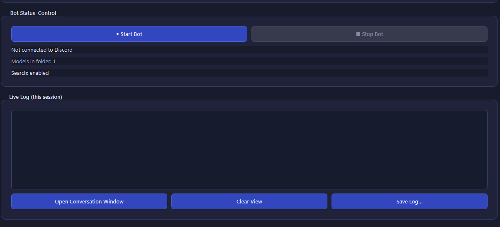
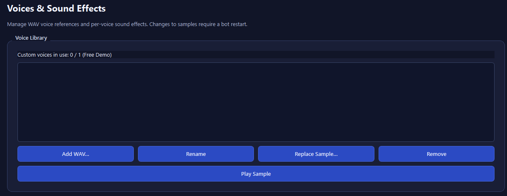

# Features
## Realtime voice conversations
Have conversations with a chatbot that responds instantly to you and your friends in Discord voice channels.

## Custom AI voices
Create and manage voices using your own audio samples. Clone voices in as little as 5 seconds of audio.

## Custom sound effects
Have a custom sound effect play when a particular voice is activated.

## GUI and Discord commands
Set everything up in an easy to use GUI, then you or your friends can issue commands in a text channel to add new voices, sound effects, control wake words, and more.

## Local AI models
Download and import Local Language Models in just a few clicks in the GUI.

## Custom personalities
Give each voice its own personality and behaviour.

## Wake words
Configure how and when Voz responds in your server.

## Web Search (Experimental)
Let Voz search the web for information when needed.

## Privacy
Installed and ran locally on your PC. Your conversations are between you and your local chatbot. Nothing is saved, no one other than whoever is in your Discord call has access to conversations.

# Guide

## 01 Download and install Voz

Download the free Windows Installer.
Run the installer and follow setup instructions. It may take a while to download all dependencies.
Launch Voz from the executable, or your desktop shortcut.

## 02 Create your Discord bot

Firstly, click "New Application" on the top right.

Give it whatever name you want. This will be used to call the bot into your voice channel when you mention it, but the nickname can later be changed in your server.

On the left side of the screen, click "Installation", then choose "None" in the dropdown for "Install Link", then save the change.

In the "Bot" section, first obtain the bot token and note it down in a notepad. This will be pasted into your GUI later. It can be reset at a later date if needed.

In this section you can toggle on Presence, Server Members, and Message Content intent, but it should not be necessary.

On the left hand side, click "OAuth2", and tick "bot" and "application.commands" in the "OAuth2 URL Generator" section. Give the bot permissions "View channels, Send messages, Embed links, Read message history, Connect, and Speak." A URL should be generated at the bottom. Copy and paste this in your web browser, and invite the bot into your server.

That should be everything needed. Make sure you have your bot token, and do not show it to anyone!

## 03 Connect Voz to Discord

Enter your token. Open the settings tab in the Voz GUI and paste your bot token at the top.

Choose your server. Make sure the bot has been invited to the Discord server you want to use.

Connect. If you already have an LLM setup you can now connect, otherwise, follow the next steps.

## 04 Download an AI model

Open LLM Manager on the left hand side. At the top, set up a model folder. You can place this wherever you like, but the simplest thing to do is create a folder called "models" inside the Voz folder.

Download a model. Select a local language model to download by searching Hugging Face at the bottom of the LLM Manager. This example uses Qwen 3 0.6b.

Allow the download to finish. Then you may need to click "Scan Folder" at the top. The model should appear in a list underneath your folder location. Select your preferred model, then click "Import Selected GGUF into Ollama". Under "Ollama Installed Models", choose the model from the dropdown and click "Use Selected Model". You may need to click "Refresh Ollama" beforehand.

At this point, you should be ready to start the bot with just the default voice, but you may need to restart the GUI in order to force an update to the settings to recognise your selected model. Click the "Dashboard" tab on the left, then click "Start bot". Join a voice channel in the same server as the bot, make sure the bot has permission to view and join that channel, and simply mention it in a text channel. Wait for the live log to say the bot is ready. You can open a conversation window to display exactly what the bot hears you say and it's generated responses.

## 05 Set up your voice

Select a voice. You can customise the voice of your bot using a voice sample. Edit a short clip, in .wav format, and save it. A 10-15 second clip works best. Make sure the voice sample is clear. Click "Add WAV" and choose your voice. It will save a copy of the WAV into your install folder into a folder called "voices". Free users are limited to one voice.

    Create custom sound effectsUsers with a paid licence can add a sound effect that plays when a particular voice is activated in the menu underneath.
    Voz Sound Effects per voice panel with Add or Replace WAV button
    Sound Effects (per voice) — click to enlarge
    To add the sound effect to an associated voice, use the Discord command "/voice sound". Type the name of the voice you want to have a sound effect, attach the WAV file, and choose whether it plays when the voice is activated, before every reply, or both. Sound effects are saved in a folder called "Sounds".
    Discord slash command voice sound with voice name, WAV sample upload and when options
    Discord /voice sound command — click to enlarge
    Adjust settingsSet your preferred wake word, voice options and personality. In the "Roles and Wake Words" tab you can set each voice to have its own personality. You can set each voice to only respond to you when a certain word is spoken. If the word is not said, it will stay silent. This is helpful if there are many people in a channel talking who may interrupt the bot.Tip: The bot may not pick up certain words if they sound similar to another word, so add multiple wake words. For example, if you want your bot to only respond to "Joe", add "John" as well, as it may mistake the words for one another. To add multiple wake words simply write "Joe, John, Jerry" without the quotation marks.You can additionally set different voices and wake words per server, but you will need your Discord server ID.
    Voz Roles and Wake Words tab showing per-voice personality, global wake word defaults and per-server wake overrides
    Roles and Wake Words — click to enlarge

